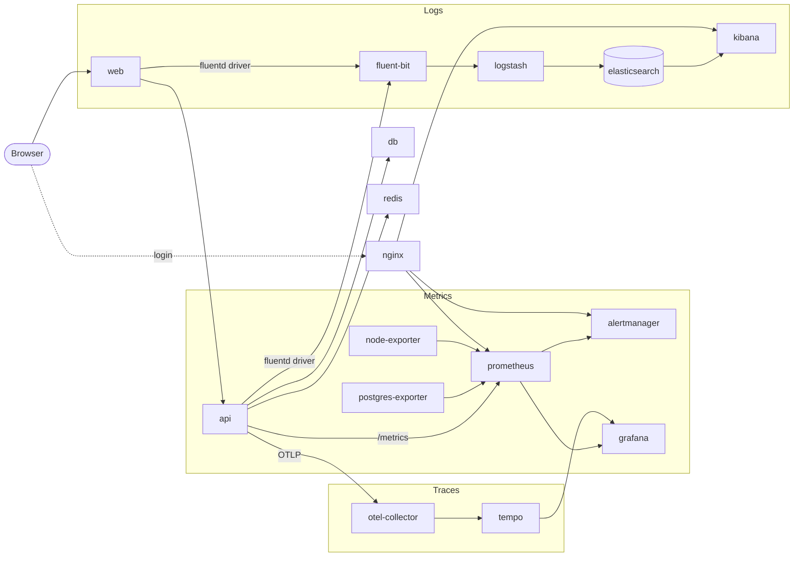

# Local deployment (`deploy/local`)

The whole application **plus the same observability the cloud runs** — metrics,
logs, and traces — on one machine, with a single command. It exists so the
DevOps modules (ELK, Prometheus/Grafana) can be demonstrated on a laptop while
the DigitalOcean environment stays torn down.

> Cloud counterpart: [`deploy/cloud`](../cloud/README.md). The stacks are
> deliberately equivalent; only the delivery mechanism differs (Docker Compose
> here, Kubernetes/Helm/Ansible there).

---

## What runs

Everything is a container in one Compose project (`warsaw-stack`), on one private
Docker network. Each row is a separate container.

All browser-facing services are reached only through the nginx HTTPS gateway — the
app/API/Grafana containers publish no host port, so every browser↔backend connection
is HTTPS (the subject's rule; internal container hops stay plain HTTP).

| Group | Service | Purpose | Exposed on host |
|-------|---------|---------|-----------------|
| **Gateway** | `nginx` | HTTPS termination for all UIs (self-signed cert) | — |
| **App** | `web` | Next.js frontend | via nginx → **https://localhost** |
| | `api` | FastAPI backend (`/metrics`, `/health`) | internal only (proxied by `web`) |
| | `db` | Postgres + pgvector | internal only |
| | `redis` | cache / rate-limit | internal only |
| **Metrics** | `prometheus` | scrapes & stores metrics (TSDB) | via nginx → https://localhost:9090 🔒 |
| | `alertmanager` | routes fired alerts | via nginx → https://localhost:9093 🔒 |
| | `grafana` | dashboards, Explore, traces | via nginx → https://localhost:3001 🔒 |
| | `postgres-exporter` | Postgres metrics (`pg_*`) | internal only |
| | `node-exporter` | host VM metrics (`node_*`) | internal only |
| **Traces** | `otel-collector` | receives OTLP spans, fans out | internal only |
| | `tempo` | trace store | internal only |
| **Logs** | `fluent-bit` | log shipper (Docker fluentd driver) | `:24224` (intake) |
| | `logstash` | log pipeline → Elasticsearch | internal only |
| | `elasticsearch` | log store / search | internal only |
| | `kibana` | log UI | via nginx → https://localhost:5601 🔒 |
| | `elk-setup` | one-shot: log retention (ILM) + archive (SLM snapshots), then exits | — |
| **Backups** | `db-backup` | nightly `pg_dump` → `deploy/local/backups/` | — |
| **Scheduler** | `ofelia` | periodic ingestion (opt-in) | — |

🔒 = requires the login set by `make infra-auth`.

---

## Architecture



**Two rules that explain the whole design:**
1. **Pull vs push.** Prometheus *pulls* metrics (scrapes `/metrics`). Traces are
   *pushed* (app → collector → Tempo). Logs are *pushed* (driver → Fluent Bit →
   Logstash → ES).
2. **Grafana/Kibana only read.** They never receive telemetry — they query the
   stores (Prometheus / Tempo / Elasticsearch) on demand.

---

## Prerequisites

- **Docker Engine + Compose v2** (v2.24+). On Debian/Ubuntu install Docker CE
  from the official apt repo (not the `docker.io`/snap package).
- **~4–6 GB RAM** free for the full stack (Elasticsearch is the heavy part).
- **Linux only:** set the Elasticsearch kernel requirement once —
  ```bash
  sudo sysctl -w vm.max_map_count=262144
  echo 'vm.max_map_count=262144' | sudo tee /etc/sysctl.d/99-elasticsearch.conf
  ```
  (Docker Desktop on macOS sets this inside its VM automatically.)
- **`backend/.env`** for the API to actually serve — `cp backend/.env.example
  backend/.env` and fill keys. `make stack-up` boots without it, but loading the demo
  data on the first run (and search) needs `ANTHROPIC_API_KEY` / `VOYAGE_API_KEY` — it
  seeds only when they are present, otherwise it skips with a hint.

On a 42 workstation (no sudo on the host) run the stack in a VirtualBox guest —
step by step in [VM_SETUP_42.md](VM_SETUP_42.md).

---

## Quick start

One command — it self-provisions the TLS cert and the infra login on first run:

```bash
make stack-up
# first run prints a generated infra login, e.g.:  admin / 9f3c…   (for Grafana/Kibana/Prometheus)
# open https://localhost  (accept the one-time self-signed warning)  ·  Grafana https://localhost:3001
```

`make stack-up` builds + starts everything; on a fresh database it also loads 100
`[TEST]` demo events + test users (`user1@test.com` / `1234`), on an existing one it
just starts. The infra UIs are secured by a random `admin` password printed once; set
your own anytime with `make infra-auth AUTH_USER=.. AUTH_PASS=..`. Stop with
`make stack-down` (data kept).

### Make commands

| Command | What it does |
|---------|--------------|
| `make infra-auth AUTH_USER=.. AUTH_PASS=..` | *optional* — set your own infra login instead of the auto-generated one (writes gitignored `.htpasswd` + `secrets.env`) |
| `make stack-up` | build + start the stack; first run also loads demo events + test users |
| `make stack-down` | stop everything (named volumes kept) |
| `make stack-logs` | follow all logs |
| `make seed-fixtures` | load the 100 `[TEST]` demo events (needs `VOYAGE_API_KEY` to embed) |
| `make seed-users` | create test users `user1@test.com` / `user2@test.com` (pw `1234`) |
| `make stack-seed` | demo fixtures + real sources (`places`, `facebook_events`) |
| `make scheduler-up` / `scheduler-down` | enable/disable periodic ingestion (ofelia) |
| `make stack-db-backup` | dump the DB now → `deploy/local/backups/` (also runs nightly) |
| `make stack-db-restore FILE=deploy/local/backups/<dump>` | replace the DB with a dump (API stopped meanwhile) |
| `make stack-logs-archive` | snapshot the log indices now (also runs nightly) |

---

## The three pillars

### Metrics — Prometheus + Grafana
Prometheus scrapes `api:8000/metrics`, `postgres-exporter:9187`,
`node-exporter:9100`, `otel-collector:8889` and itself, stores 7 days of
time-series, and evaluates alert rules. Grafana reads Prometheus.
- Config: [`config/prometheus.yml`](config/prometheus.yml) (scrape jobs),
  [`config/prometheus-rules.yml`](config/prometheus-rules.yml) (alerts),
  [`config/alertmanager.yml`](config/alertmanager.yml).
- Grafana is auto-provisioned: datasources + dashboards under
  [`config/grafana/`](config/grafana) (*App Overview*, *Search Analytics*,
  *Host / VM*).

### Logs — ELK (Fluent Bit → Logstash → Elasticsearch → Kibana)
`api`/`web` log via the Docker **fluentd** driver → **Fluent Bit** (`forward`
input) → **Logstash** (`tcp json_lines`) → **Elasticsearch** (index
`warsaw-logs-*`) → **Kibana**.
- Config: [`config/fluent-bit/fluent-bit.conf`](config/fluent-bit/fluent-bit.conf),
  [`config/logstash/pipeline/logstash.conf`](config/logstash/pipeline/logstash.conf).
- In Kibana create the index pattern `warsaw-logs-*` (time field `@timestamp`) once.
- **Retention and archiving** ([`config/elasticsearch/setup.sh`](config/elasticsearch/setup.sh),
  applied by the one-shot `elk-setup` on every `make stack-up`):
  - *archive* — the SLM policy `warsaw-logs-nightly` snapshots `warsaw-logs-*` at 01:30 UTC
    into the fs repository `warsaw-logs-archive` (volume `es-snapshots`); snapshots are kept
    365 days. `make stack-logs-archive` takes one now.
  - *retention* — the ILM policy `warsaw-logs-policy` deletes a daily index 30 days after it
    was created, but only after a snapshot ran (`wait_for_snapshot`), so nothing is deleted
    before it is archived. New indices get it from the `warsaw-logs` index template.
  - See it in Kibana → **Stack Management** → *Index Lifecycle Policies* and
    *Snapshot and Restore*. Tune with `LOG_RETENTION_DAYS` / `LOG_ARCHIVE_DAYS` on `elk-setup`.

### Traces — OpenTelemetry → Tempo
The API is instrumented (`app/observability.py`) and pushes OTLP spans to the
**otel-collector**, which forwards them to **Tempo**. View a request's waterfall
in Grafana → Explore → Tempo.
- Config: [`config/otel-collector.yaml`](config/otel-collector.yaml),
  [`config/tempo.yaml`](config/tempo.yaml).

---

## Security model

Auth is applied to **external** access only; internal container-to-container
traffic stays on the trusted Docker network.

- **`nginx` auth gateway** — basic-auth (from `.htpasswd`) in front of Kibana,
  Prometheus, Alertmanager. Their raw ports are not published; nginx is the only
  way in. Mirrors the cloud nginx that fronts Kibana. Config:
  [`nginx/nginx.conf`](nginx/nginx.conf).
- **Grafana** — its own login, password from `secrets.env`.
- **Not exposed at all** — Elasticsearch, Tempo, node/postgres-exporter,
  otel-collector: internal only, nothing to attack.
- **Secrets** — `.htpasswd` and `secrets.env` are generated by `make infra-auth`
  and git-ignored. `stack-up` refuses to start until they exist.

---

## Scheduled ingestion (ofelia)

Local mirror of the cloud Kubernetes CronJobs. The `ofelia` scheduler reads
`ofelia.*` labels on the `api` service and runs the ingestion runner inside it on
a schedule (`places` Mon 04:00, `facebook_events` every 6h, `ticketmaster` every
12h). **Opt-in** (compose profile) so a plain `stack-up` never quietly calls
external APIs:

```bash
make scheduler-up      # enable ;  make scheduler-down to stop
```
Change a schedule in the `ofelia.job-exec.*.schedule` labels (6-field cron or
`@every 2m`), then `docker compose … up -d api && make scheduler-down && make scheduler-up`.

To ingest **now** (no waiting), just run the runner directly:
`docker compose -f deploy/local/docker-compose.yml exec api python -m app.ingestion.runner --source=places`.

---

## Data & persistence

Named volumes survive `stack-down` (only `down -v` wipes them):
`pgdata` (DB), `prometheus-data`, `grafana-data`, `tempo-data`, `es-data`, `es-snapshots`.
So seeding is a one-time step.

### Database backups
The `db-backup` service (`postgres:16-alpine` + crond) dumps the `events` DB every night at
03:00 UTC to `deploy/local/backups/events_<UTC timestamp>.dump` and deletes dumps older than
7 days. The directory is a host bind mount, outside every Docker volume, so the dumps survive
`down -v` and a lost `pgdata` (it is gitignored: dumps hold user data).

```bash
make stack-db-backup                                            # dump now
make stack-db-restore FILE=deploy/local/backups/events_<…>.dump  # restore (stops the API meanwhile)
BACKUP_SCHEDULE='* * * * *' make stack-up                       # watch the cron fire; `make stack-up` reverts
```
Script: [`config/db-backup/backup.sh`](config/db-backup/backup.sh). Recovery runbook:
[DISASTER_RECOVERY.md](../../docs/DISASTER_RECOVERY.md#local-stack).

---

## Troubleshooting

| Symptom | Fix |
|---------|-----|
| `stack-up` refuses to start | run `make infra-auth …` first |
| Elasticsearch won't start (Linux) | `vm.max_map_count=262144` (see prerequisites) |
| Kibana empty | create index pattern `warsaw-logs-*`; generate traffic; check `logs fluent-bit logstash` |
| Grafana panel empty | widen the time range; make sure you generated activity |
| 502 through nginx | upstream still starting — wait a few seconds |
| Search returns nothing | set `VOYAGE_API_KEY` in `backend/.env`, then re-seed |

Verify from inside (services aren't published):
```bash
docker compose -f deploy/local/docker-compose.yml exec elasticsearch curl -s localhost:9200/_cat/indices?v
docker compose -f deploy/local/docker-compose.yml ps
```

---

## Layout

```
deploy/local/
  docker-compose.yml        # the whole stack
  nginx/nginx.conf          # auth gateway (basic-auth reverse proxy)
  config/
    prometheus.yml          # scrape jobs
    prometheus-rules.yml    # alert rules
    alertmanager.yml        # alert routing (null receiver locally)
    otel-collector.yaml     # OTLP → Tempo + Prometheus exporter
    tempo.yaml              # trace store
    fluent-bit/…            # log shipper
    elasticsearch/setup.sh  # log retention (ILM) + archive (SLM), run by elk-setup
    db-backup/backup.sh     # pg_dump, run nightly by db-backup
    logstash/pipeline/…     # log pipeline → Elasticsearch
    grafana/…              # provisioned datasources + dashboards
  .htpasswd, secrets.env    # generated by make infra-auth (git-ignored)
  backups/                  # DB dumps from db-backup (git-ignored)
```
